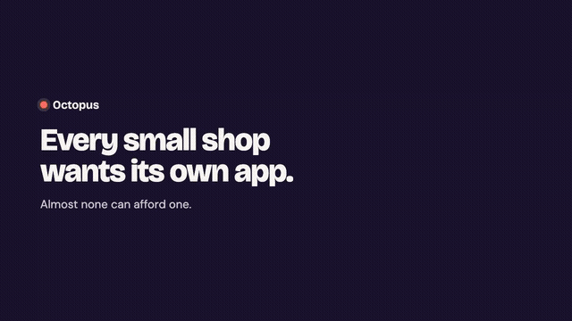
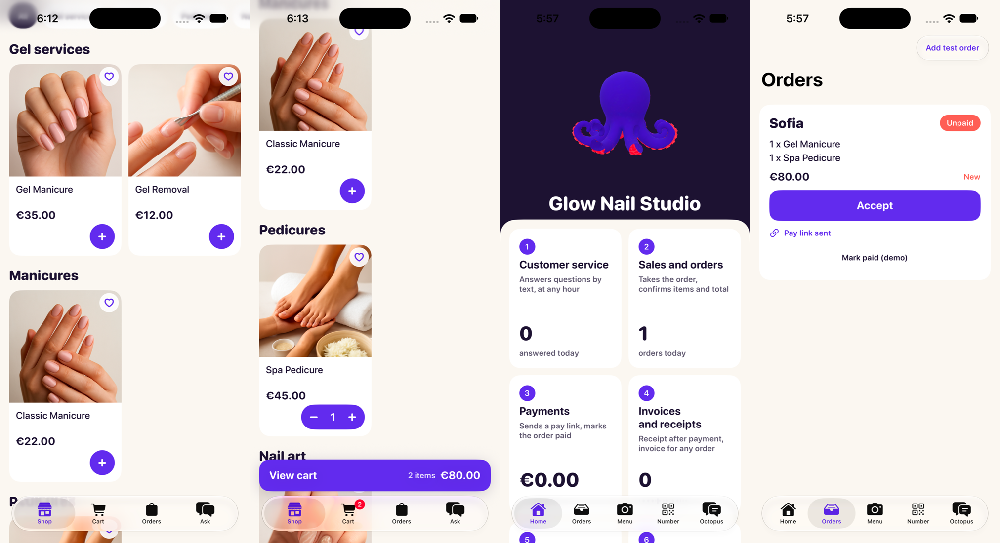
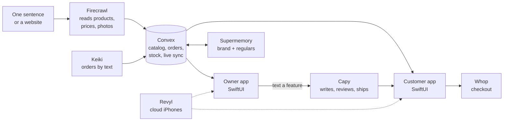

<div align="center">


# Octopus

### Build an app for your consumers.

Paste your website, or describe your shop in one sentence.<br>
Octopus builds a native iPhone app for your customers, and a second one for you to run the shop.

[**Try it live**](https://hushed-dove-252.convex.site) · [**Watch the demo**](demo/octopus-demo.mp4) · [How it works](#how-it-works) · [Run it yourself](#run-it-yourself)

<br>



</div>

<br>

## Why

Every small shop wants its own app. Almost none can afford one. A salon, a grocer or a cafe gets quoted months and five figures for something their customers would open twice a week.

Octopus turns that into a text box. One sentence in, a running business out.

<div align="center">

<br>
<sub>Left: the customer app Octopus built for a nail studio. Right: the owner app, with the same order arriving live.</sub>
</div>

## What you get

| | |
|---|---|
| **A customer app** | Native SwiftUI. Categories, search, product photos, cart, order tracking, and a chat that knows the menu. |
| **An owner app** | Native SwiftUI. Live orders, an inbox for complaints and questions, menu and stock, twelve business tools on one dashboard. |
| **An agent on a text line** | Customers can order by iMessage. The owner can run the shop by text: "we have 12 samosas left", "how much did we make today?" |
| **A real checkout** | One payment link per order, for the exact total, in the shop's currency. |
| **A brain** | The shop's brand voice and every regular's usual order, remembered across conversations. |
| **An app that grows** | The owner texts "add a loyalty stamp card". A cloud coding agent writes it, reviews it, and ships it. |

## How it works



1. **Describe the shop.** A website, or a name and a sentence. That is the whole setup.
2. **Octopus reads it.** Products, prices, photos and address come from the site. Items with no photo get one generated.
3. **The catalog goes live.** Everything lands in Convex, sorted into categories. Every screen subscribes, so nothing needs a refresh.
4. **Customers order.** In the app, or by text. Prices and stock are checked on the server, never trusted from the phone.
5. **The owner sees it.** The order lands on the owner's phone. Accept, ready, done. The customer watches the status change.
6. **The app improves.** A feature request becomes a Capy thread, then a pull request, then a release. The owner gets a text when it is live.

## The stack

| Platform | What it does here |
|---|---|
| [Convex](https://convex.dev) | Database, HTTP actions, file storage, scheduler. Also serves the landing page and dashboard. |
| [Keiki](https://onkeiki.com) | Two agents on a text line: one answers shoppers, one runs the shop for the owner. |
| [Whop](https://whop.com) | A checkout created per order. |
| [Supermemory](https://supermemory.ai) | One namespace per shop for brand facts, owner notes, and each customer. |
| [Capy](https://capy.ai) | A cloud agent that builds requested features on a branch and opens a pull request. |
| [Revyl](https://revyl.ai) | Builds both apps, runs them on cloud iPhones, and runs the end to end tests. |
| OpenAI | `gpt-4.1-mini` for the agent loops, `gpt-image-1-mini` for missing product photos. |
| Firecrawl | Reads the shop's website. |
| SwiftUI + XcodeGen | Both iPhone apps. No web views. |

## Repo map

```
convex/        backend: schema, agents, onboarding, payments, memory, the landing page
ios/           owner app (SwiftUI)
shop-ios/      customer app (SwiftUI)
scripts/       smoke test, phone builds, feature release runner
demo/          demo video, screenshots, sponsor captures
AGENTS.md      the rules the coding agent must follow when it ships a feature
```

## Run it yourself

You need Node, Xcode, [XcodeGen](https://github.com/yonaskolb/XcodeGen), and a Convex account.

```bash
git clone https://github.com/techadnank9/octopus.git
cd octopus
npm install
npx convex dev
```

Set these on your Convex deployment (`npx convex env set NAME value`):

| Variable | Needed for |
|---|---|
| `OPENAI_API_KEY` | agents, catalog drafting, photo generation |
| `FIRECRAWL_API_KEY` | reading a shop's website |
| `SUPERMEMORY_API_KEY` | brand and customer memory |
| `WHOP_API_KEY` | checkout links |
| `CAPY_API_KEY`, `CAPY_PROJECT_ID` | building features on request |
| `AGENT_SECRET` | authenticating the Keiki agents' webhooks |

Then open the landing page at your deployment's `.convex.site` URL and create a shop.

For the iPhone apps, put your Convex URL in `ios/Config.xcconfig` and `shop-ios/Config.xcconfig`, then:

```bash
cd ios && xcodegen && open Octopus.xcodeproj
```

```bash
cd shop-ios && xcodegen && open OctopusShop.xcodeproj
```

Check a live deployment end to end:

```bash
python3 scripts/smoke.py
```

## What is real and what is not yet

This was built in one day at the YC Consumer Mobile Hackathon. In the spirit of not overselling:

**Working today**
- Onboarding from a website or a sentence, with categories and photos
- Both native apps, verified on Revyl cloud iPhones
- Orders with server side pricing and stock checks, live on both phones
- Whop checkout links for the exact total
- Owner agent and customer agent, with memory
- Feature requests built by Capy and shipped, three times so far (favourites, a favourites fix, a loyalty stamp card)

**Not there yet**
- Payment confirmation is a demo button. The Whop webhook is not wired up.
- Features built on request ship to the customer web storefront, not yet to the native app.
- The release step runs from a script on a laptop, not from a hosted agent.
- One shop per text line at a time.

## Roadmap

- [ ] Whop webhook, so "paid" is automatic
- [ ] Requested features shipped into the native customer app
- [ ] Hosted release agent, no laptop in the loop
- [ ] TestFlight links generated per shop
- [ ] Android customer app

## Contributing

Issues and pull requests are welcome. If you run a small shop and something here would not survive a Saturday rush, that is the most useful issue you can open.

<div align="center">
<br>

**If Octopus would have helped a shop you know, a star helps other people find it.**

Built by [Mohammed Adnan](https://github.com/techadnank9)

</div>
